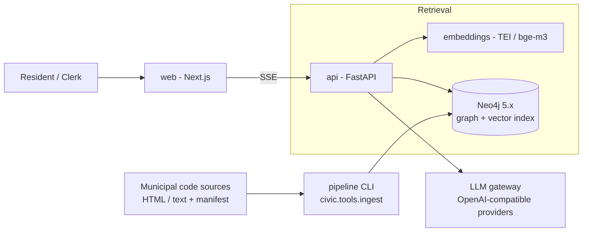

# CivicGraph

**Civic Knowledge Graphs: Democratizing Local Legal Intelligence**

CivicGraph is a retrieval system that lets residents, clerks, and policy staff
query municipal bylaws and regulations in plain language and receive answers
grounded in cited, versioned legal text. It combines a legal knowledge graph
(Neo4j) with a hybrid retrieval pipeline and a multilingual answer layer.

Status: **v0.3 — pilot implementation** (single-jurisdiction demo corpus included).

---

## Why this exists

Municipal codes are written for lawyers. Residents who want to know whether
they can build a fence, run a business from home, or keep chickens usually end
up at a front-counter desk or on hold with the clerk's office. CivicGraph turns
the municipal code into a queryable knowledge base: every answer carries a
citation to the exact article in force, in the reader's language, with an
explicit refusal when the corpus does not support an answer.

The project aligns with UN SDG 16 (peace, justice and strong institutions)
and SDG 11 (sustainable cities and communities). See
[docs/product-brief.md](docs/product-brief.md).

## Architecture at a glance



Design principle: **the graph is the source of truth; the model is only the
interface.** Answers are generated strictly from retrieved articles, citations
are validated before they reach the user, and low-evidence questions receive a
referral instead of a guess. The full rationale lives in
[docs/architecture.md](docs/architecture.md) and the ADRs.

## Repository layout

| Path            | Contents                                                        |
|-----------------|-----------------------------------------------------------------|
| `docs/`         | Product brief, architecture, ontology, retrieval design, API spec, security, operations, evaluation, glossary |
| `docs/adr/`     | Architecture decision records                                   |
| `server/`       | FastAPI service, retrieval pipeline, ingestion/enrichment CLIs   |
| `web/`          | Next.js 14 public portal and chat interface                     |
| `deploy/`       | Neo4j schema bootstrap used by ops and CI                       |
| `evals/`        | Golden-set cases for the smoke evaluation harness               |
| `samples/`      | Fictional single-city corpus used for local development         |

## Quickstart

Prerequisites: Docker (with Compose v2), Python 3.11+ if running the API
outside containers.

```bash
cp .env.example .env

# Neo4j, embedding service, API, web portal
docker compose up -d --build

# Load the demo corpus into the graph
docker compose exec api python -m civic.tools.ingest --source /data/samples/rivermont

# Enrich the graph with cross-references and concepts (uses the configured LLM)
docker compose exec api python -m civic.tools.enrich --limit 200
```

With the stack running, execute the golden-set smoke gate (24 curated cases;
hard gates on retrieval hit@5 and refusal correctness) from the host:

```bash
cd server && python dev/eval_harness.py --api http://localhost:8000
```

Then open <http://localhost:3000>. The API is served at
<http://localhost:8000> (OpenAPI docs at `/docs`).

To run the API directly:

```bash
cd server
python -m venv .venv && .venv/Scripts/activate   # or source .venv/bin/activate
pip install -e ".[dev]"
uvicorn civic.main:app --reload --port 8000
pytest
```

### Running without Docker (native Windows/Linux)

The full pipeline has been verified end-to-end on a plain machine with no
container runtime:

1. **Neo4j**: download `neo4j-community-5.26.x-windows.zip` plus a Java 21 JRE,
   set an initial password (`neo4j-admin dbms set-initial-password ...`), start
   with `bin\neo4j.bat console`.
2. **Embeddings** (in place of TEI): `pip install fastembed`, then
   `python server/dev/embed_shim.py` - serves the TEI wire contract on CPU.
   Default model is `BAAI/bge-small-en-v1.5` (384-dim, English); set
   `EMBED_MODEL=sentence-transformers/paraphrase-multilingual-MiniLM-L12-v2`
   for cross-lingual testing (same 384-dim). After any model switch run
   `python -m civic.tools.ingest --re-embed` to re-embed existing chunks.
   Set `EMBEDDING_DIM=384` on the API side.
3. **Generation**: any OpenAI-compatible server works. Verified with Mozilla
   llamafile 0.10.5 + `Qwen2.5-1.5B-Instruct-Q4_K_M` (~60 tok/s on CPU).
   Point `LLM_BASE_URL` at its `/v1`.
4. Ingest and ask:

```bash
set NEO4J_URI=bolt://127.0.0.1:7687 & set NEO4J_PASSWORD=... & set EMBEDDING_DIM=384
python -m civic.tools.ingest --source ../samples/rivermont
python dev/demo_chat.py "Can I keep bees in my backyard?"
```

Note: the shim and demo scripts are development conveniences; production runs
TEI with bge-m3 (1024-dim) per the architecture doc.

### Clerk console

`/admin` on the portal is the review-gate and audit interface for clerk staff:
publish pending amendments (with effective date), browse recent assistant
sessions with finish status and latency, and inspect any session by query id
(runbook RB-4). It authenticates against the same three modes as the admin API
(ADMIN_TOKEN, or OIDC once configured); the token is held in the browser's
localStorage only.

### Embedding the assistant on another site

The portal shows a floating assistant bubble on every page. The same chatbot
can be mounted on any external site (e.g., the city's existing website) with a
single script tag:

```html
<script
  src="http://your-portal-host:3000/embed.js"
  data-api-base="http://your-api-host:8000"
  data-title="City Assistant"
  data-accent="#1a4274"
  data-greeting="Ask me about municipal by-laws."
></script>
```

All `data-*` attributes are optional. The widget renders in a shadow DOM, so
host-page styles cannot break it, streams answers over SSE, and shows the same
validated citations as the portal. The API's CORS configuration
(`CIVIC_CORS_ORIGINS`) must include the host site's origin in production.

## Documentation map

| Document | Purpose |
|----------|---------|
| [Product brief](docs/product-brief.md) | Problem, users, scope, success metrics, risks |
| [Architecture](docs/architecture.md) | Components, data flows, latency budget, stack rationale |
| [Legal ontology](docs/legal-ontology.md) | Node/relationship model, temporal versioning, Cypher DDL |
| [Retrieval design](docs/retrieval-design.md) | Hybrid search, graph expansion, grounding and refusal rules |
| [API specification](docs/api-spec.md) | REST + SSE contract, error model, examples |
| [Security & governance](docs/security-and-governance.md) | Threat model, privacy, accessibility, content policy |
| [Operations](docs/operations.md) | Environments, deployment, SLOs, runbooks, cost envelope |
| [Evaluation](docs/evaluation.md) | Golden set, offline metrics, CI gates, online signals |
| [Glossary](docs/glossary.md) | Legal and technical terminology |
| [ADR index](docs/adr/) | Six decision records covering the major architectural choices |

## Scope and limits

- The bundled corpus (`samples/rivermont`) is **fictional** and exists so the
  stack runs end-to-end without licensing concerns.
- Case law and provincial/state statutes are out of scope for phase 1;
  see the product brief's non-goals section.
- The system provides legal *information*, not legal *advice*. This boundary
  is enforced in product copy, prompts, and the refusal path.

## License and ownership

License selection is pending review by the adopting municipality's legal
counsel. Until then, all rights reserved by the commissioning authority.
Contact: `platform-team@example.org` (placeholder).
