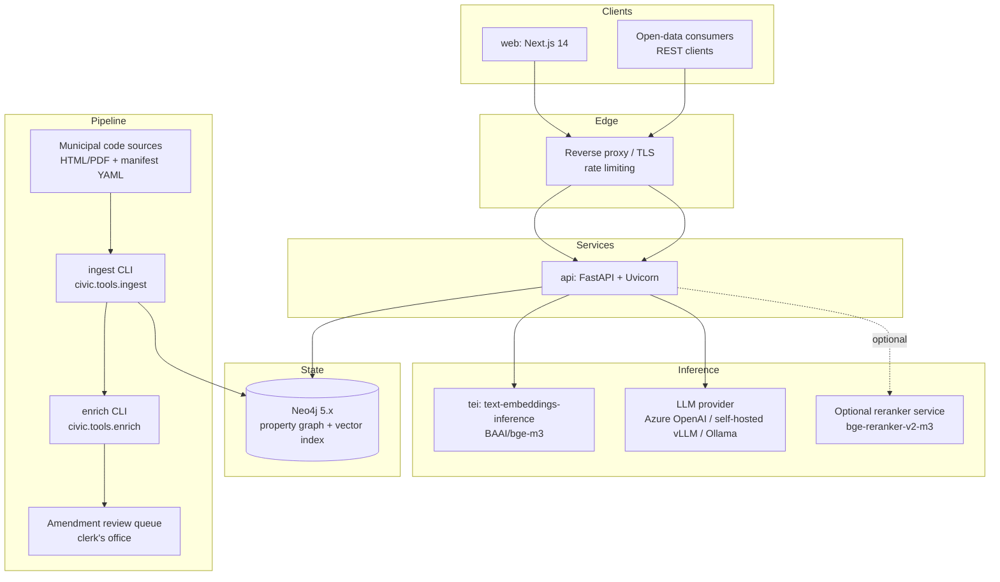
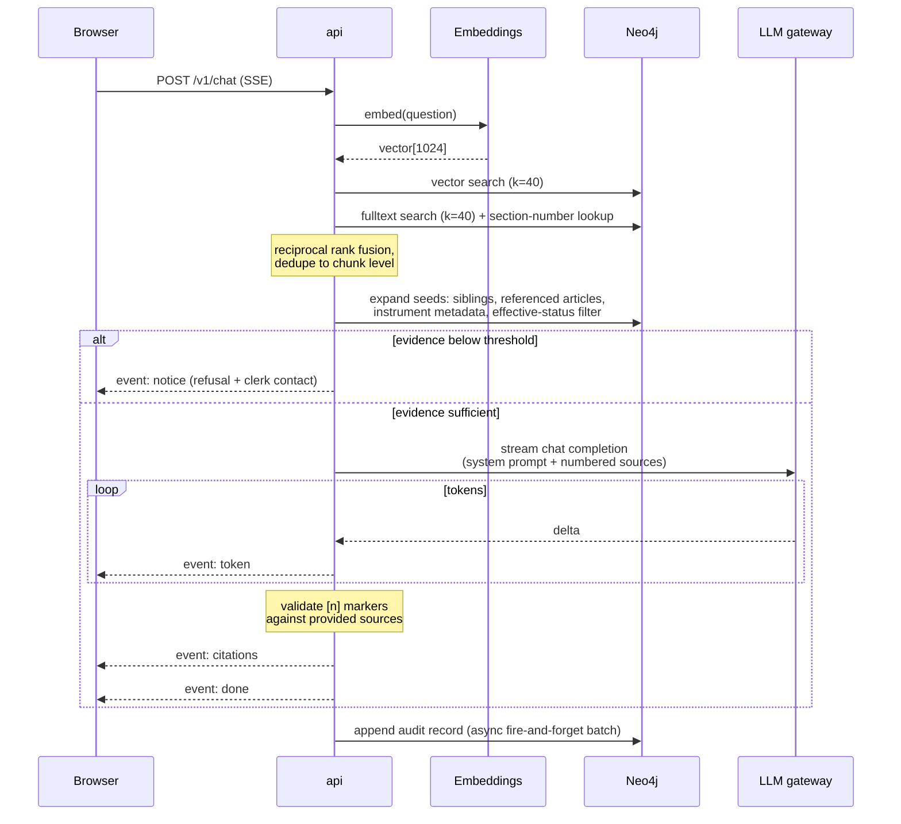

# CivicGraph System Architecture

| | |
|---|---|
| Document status | Draft for review |
| Version | 0.3 (2026-08-26) |
| Related | [ADR-001](adr/ADR-001-neo4j-as-graph-and-vector-store.md), [ADR-002](adr/ADR-002-fastapi-service-layer.md), [ADR-003](adr/ADR-003-provider-agnostic-model-gateway.md) |

---

## 1. Context

One public web client, one API service, one graph database, two inference
services (embeddings, generation). Peak load for a mid-size municipality is
modest — design point is **5 requests/second sustained, 20 rps burst** — so the
architecture optimizes for correctness, auditability, and operational
simplicity rather than horizontal scale.

## 2. Component responsibilities

### 2.1 `web` — Next.js 14 portal

Server-rendered landing/search pages; a client-side chat view consuming the
SSE endpoint. The web tier holds no state beyond the browser: no session store,
no answer cache. Citations link out to the canonical source document at the
article anchor, which keeps the clerk's office website authoritative.

Deliberately minimal: no analytics SDK, no client-side feature flags, no
server actions calling the LLM directly. All generation goes through `api`
so that audit logging, rate limiting, and refusal logic have a single choke point.

### 2.2 `api` — FastAPI service

Owns everything that must be uniform across clients:

- **Retrieval orchestration**: embed query → hybrid candidate generation →
  reciprocal-rank fusion → graph expansion → (optional) cross-encoder rerank.
- **Grounded generation**: prompt assembly, streaming from the LLM gateway,
  citation validation, refusal path.
- **Public read API** for instruments/articles (open-data use).
- **Audit logging**: query text, retrieved chunk ids, model, latency, refusal flag.

Stateless; scales horizontally behind the proxy. Schema bootstrap runs at
startup (idempotent `CREATE INDEX ... IF NOT EXISTS`), so a fresh environment
needs only Neo4j plus configuration.

### 2.3 `neo4j` — graph + vector store (ADR-001)

Single database holds the legal ontology (instruments, articles, amendments,
concepts, references) *and* the dense index over article chunks. One write path,
one backup story, and — critically — retrieval can traverse relationships
(`REFERENCES`, `AMENDS`, `PART_OF`) in the same query that scores vectors.
Splitting graph and vector stores was rejected; see ADR-001.

### 2.4 Inference services

- **Embeddings**: Hugging Face TEI serving `BAAI/bge-m3` (1024-dim, strong
  cross-lingual retrieval). Swappable via config.
- **Generation**: any OpenAI-compatible chat-completions endpoint through the
  gateway (`llm.py`). Production default is Azure OpenAI or a self-hosted
  vLLM deployment depending on municipal data-residency policy; local
  development uses Ollama. Anthropic supported natively.
- **Reranker** (optional): bge-reranker-v2-m3 via TEI's `/rerank` route.
  Measured benefit on legal text is real but modest after graph expansion;
  disabled by default until the eval harness shows it clears its latency cost.

### 2.5 Pipeline

`civic.tools.ingest` parses source documents into articles and chunks using a
per-jurisdiction heading profile, computes stable content-hash IDs, embeds in
batches, and MERGEs idempotently. `civic.tools.enrich` runs the LLM over
articles to extract cross-references and concept links, writing only validated
relationships. Amendments land in a review state; publication is a human action.

## 3. Query path (the request that matters)

Latency budget (p95 targets, single region):

| Stage | Budget |
|---|---|
| Query embedding | 40 ms |
| Vector + fulltext + section queries (parallel) | 50 ms |
| Graph expansion | 30 ms |
| Rerank (when enabled) | 150 ms |
| Prompt assembly + gateway overhead | 80 ms |
| First token | ≤ 1.5 s cumulative |
| Complete short answer (~250 tokens) | ≤ 8 s |

## 4. Ingestion path

1. Clerk's office drops an export: one file per instrument plus `manifest.yaml`
   (jurisdiction metadata, kind, number, dates, status).
2. `ingest` parses headings into articles per the jurisdiction profile,
   chunks with article-boundary awareness (ADR-004), embeds, and MERGEs.
   Re-running is safe: IDs are content-stable hashes.
3. `enrich` extracts cross-references ("see section 12(3)") and topical
   concepts, validating LLM output against strict schemas before any write.
4. Amendments arrive with `status: pending_review` and do not appear as
   current law until a human publishes them. The freshness job compares the
   official feed hash nightly and opens a ticket on drift (operations doc §6).

## 5. Technology choices and rationale (summary)

| Layer | Choice | Why this and not the alternative |
|---|---|---|
| Graph DB | Neo4j 5.x | Native vector index + mature Cypher; the ontology queries are graph-shaped. PostgreSQL/pgvector would work but forces recursive CTEs where Cypher is natural |
| Service framework | FastAPI (Python 3.12) | Async-first for SSE streaming; Pydantic contracts; the ML ecosystem lives here (ADR-002) |
| Orchestration frameworks | None | Hand-rolled pipeline (~600 lines). LangChain/LlamaIndex abstract exactly the parts we need to control: prompts, retrieval order, citation handling. Fewer layers to debug, no version churn (see architecture notes in retrieval doc §7) |
| Embeddings | bge-m3 via TEI | Multilingual without per-language indexes; self-hostable; MIT license |
| Generation | Gateway over OpenAI-compatible APIs | Provider portability is a policy requirement, not a nicety (ADR-003) |
| Frontend | Next.js 14 App Router | SSR for the public pages; streaming fetch for chat is ~80 lines of client code |
| AuthN (phase 1.5) | OIDC via municipal IdP | Public read endpoints are open by design; admin routes take JWTs |

## 6. Failure modes and degradation

| Failure | Behavior |
|---|---|
| Embedding service down | `/v1/chat` returns 503 with `Retry-After`; keyword-only search remains available on `/v1/search?mode=keyword` |
| LLM unavailable or timeout | Chat emits a notice event explaining generation is unavailable; sources are still streamed so the user gets raw articles |
| Neo4j down | Health checks fail; proxy pulls instances from rotation; static "service unavailable" page on web tier |
| Corrupt/failed ingestion run | Writes are transactional per instrument; a failed instrument leaves prior version intact; ingest report lists failures |

## 7. What we deliberately did not build

- No conversation memory server-side: each question is answered against the
  full corpus independently. Follow-up context is passed by the client within
  a request. This keeps privacy surface minimal and simplifies caching.
- No fine-tuning. Domain adaptation comes from retrieval quality and prompts;
  the corpus changes weekly, weights would not.
- No multi-tenant graph partitioning yet. Phase 1 is one jurisdiction; when a
  second arrives we will revisit (likely separate databases behind a routing
  layer, not shared-node tenancy — legal corpora do not want accidental joins).
